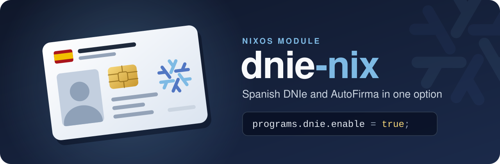
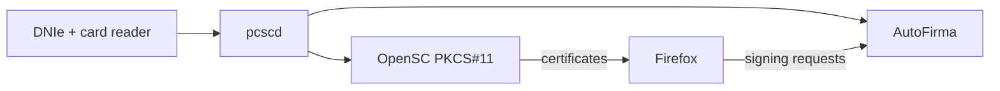

<div align="center">



[](https://github.com/kevinpita/dnie-nix/actions/workflows/build.yml)
[](https://github.com/kevinpita/dnie-nix/actions/workflows/update.yml)
[](https://nixos.org)
[](LICENSE)

[Features](#features) • [Getting started](#getting-started) • [Check your card](#check-your-card) • [Options](#options) • [Update](#update)

</div>

Use your Spanish electronic ID card (DNIe) on NixOS with one option: `programs.dnie.enable = true;`

## Features

- **pcscd**, the smart card daemon, with `opensc` and `pcsc-tools`.
- **AutoFirma** from [autofirma-nix](https://github.com/nix-community/autofirma-nix), built with the nixpkgs of this flake, with Firefox integration and access to pcscd.
- **Firefox** loads the OpenSC PKCS#11 module, so websites can read your certificates.
- **Daily updates**. A workflow updates nixpkgs and autofirma-nix, refreshes the Maven hashes, and builds AutoFirma. It pushes the update only when the build passes.



## Getting started

You need NixOS with flakes on `x86_64-linux`, and a smart card reader.

Add the input and the module to your NixOS flake:

```nix
{
  inputs = {
    nixpkgs.url = "github:NixOS/nixpkgs/nixos-unstable";
    dnie-nix.url = "github:kevinpita/dnie-nix";
  };

  outputs = { nixpkgs, dnie-nix, ... }: {
    nixosConfigurations.myhost = nixpkgs.lib.nixosSystem {
      modules = [
        ./configuration.nix
        dnie-nix.nixosModules.default
        {
          programs.dnie.enable = true;
          programs.firefox.enable = true;
        }
      ];
    };
  };
}
```

Then rebuild:

```sh
sudo nixos-rebuild switch --flake .#myhost
```

> [!IMPORTANT]
> Do not add `inputs.nixpkgs.follows` to `dnie-nix`. AutoFirma is built with Maven, and the hashes in `fixed-output-derivations.lock` only match the Maven of the nixpkgs that this flake pins. With your nixpkgs, the build fails with `hash mismatch in fixed-output derivation '…-jmulticard-dependencies.drv'`.

> [!NOTE]
> AutoFirma is not in a binary cache, so the first build compiles it locally. This takes a few minutes.

## Check your card

Put the card in the reader, then run:

```sh
pcsc_scan
```

`pcsc_scan` shows the reader and the card ATR. Then open AutoFirma, or sign in to a site that uses the DNIe, for example the Agencia Tributaria.

> [!TIP]
> If Firefox does not show the certificates, restart Firefox after the first rebuild. Firefox reads the PKCS#11 policy only at start.

## Options

| Option | Default | Description |
|---|---|---|
| `programs.dnie.enable` | `false` | Enable pcscd, OpenSC, AutoFirma, and the Firefox integration. |

The module sets the `programs.autofirma` options of autofirma-nix with `mkDefault` where it can, so you can still change them. For example, to turn off the Firefox integration of AutoFirma:

```nix
programs.autofirma.firefoxIntegration.enable = false;
```

See the [autofirma-nix documentation](https://nix-community.github.io/autofirma-nix/) for all AutoFirma options.

## Update

Your system gets new versions when you update the input:

```sh
nix flake update dnie-nix
```

To refresh the Maven hashes by hand, for example after you change the nixpkgs pin of this repository, run this in the repository root:

```sh
nix run .#update-hashes
```
